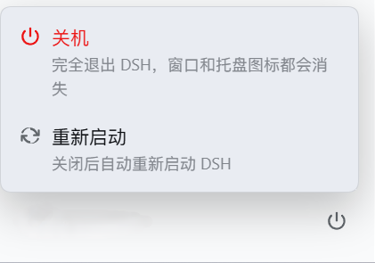

# dsh-plugin-power-button


[English](README.en.md)


> 给 DeepSeek Harness（DSH）桌面端的侧边栏加一个 **关机按钮**：它出现在左下角**用户按钮的最右侧**，点开只有一个 **关机** 和一个 **重新启动** —— 不掺杂「设置 / 用户反馈 / 退出登录」，也**不会**像点窗口关闭那样缩进任务栏托盘。



```text
┌──────────────────────────────┐
│  … 侧边栏会话列表 …           │
│                              │
│                              │
│  [ 头像 用户名 ]        (⏻)  │   ← 用户按钮最右侧新增的关机按钮
└──────────────────────────────┘
                    ↑ 点开后只有两项：
                      ⏻ 关机     完全退出 DSH（窗口 + 托盘图标都消失）
                      ↻ 重新启动  完全退出后自动重新启动 DSH
```

---

## 功能

- **位置**：侧边栏底部用户（账号）按钮的**右侧**、同一行最右端。
- **只做两件事**：点开是小菜单，只有「关机」和「重新启动」，各自带一行说明。没有设置、没有用户反馈、没有退出登录。
- **关机 = 完全退出**：结束 Electron 外壳进程，窗口消失、**任务栏托盘图标也消失**——和点窗口右上角 ×（Windows 上只会缩进托盘）完全不同。
- **重新启动 = 关机 + 自动拉起**：先完全退出，等 Web 端口释放后自动重新启动 DSH，**并回头确认端口真的重新在监听**（新实例确实起来了）。
- **有未完成的工作才二次确认**：与 DSH 自带退出确认的规则一致——只要还有正在运行的会话、排队消息、后台任务，**或者已装载会话里的定时提醒**，就先弹确认框；连状态都查不出来时也按「有工作」处理，先问一句。空闲时点一下直接执行。
- **非桌面端自动隐藏**：`dsh web`（终端里跑的、没有桌面外壳可关）按钮不显示，接口也会明确拒绝。
- 中英双语，跟随界面语言。

---

## 它到底做了什么（机制）

DSH 桌面端是**两个进程**：

- **Electron 外壳**：窗口、托盘图标，唯一拥有 `app.quit()` 的进程；
- **Host 子进程**：跑 Cordis 配置、Web 服务和所有插件的 Node 进程。

插件的 Host 部分跑在后者里，所以没有 `electron` 模块、没有 `app.quit()`。而外壳与 Host 之间的 IPC 是一条**严格白名单**通道：Host 发一个外壳不认识的消息，外壳会判定 Host 出错并直接把它杀掉；渲染进程侧也没有暴露任何退出通道；「关闭窗口」在 Windows 上恰恰等于缩到托盘。

所以本插件走**进程归属**：Host 子进程是被外壳直接 `spawn` 出来的，因此 `process.ppid` 就是外壳 pid、`process.execPath` 就是外壳可执行文件。点击之后：

1. Host 先在 2 秒上限内**尽力刷盘**活动会话（超时也继续，不会卡住整个动作）；
2. 启动一个**独立的后台助手**，把外壳 pid、Host 自身 pid、可执行文件、Web 端口和动作交给它；
3. **先把 HTTP 响应回给页面**；助手等 1.2 秒后结束外壳进程；
4. 外壳一死，Host 那条 IPC 通道断开，Host 触发**自己设计的优雅停机**，Web 端口随之释放；
5. 助手等端口释放；**只有在 Host 迟迟不退**（异常）时才升级为结束 Host 子进程——渲染/GPU 进程会随浏览器进程自然退出，不需要清整棵树；
6. 若是「重新启动」，等端口空闲后再启动一次 DSH，并等待端口重新监听来**验证**它真的起来了。

### 助手是 Node 脚本，不是 PowerShell

早期实现用的是 `powershell -ExecutionPolicy Bypass -EncodedCommand <base64>`。那正是恶意软件的典型特征，终端防护完全有权拦掉，被拦之后「关机」就变成「点了没反应」。助手需要的三件事（结束进程、探测回环端口、启动程序）都是 Node 内置能力，所以现在是一份**可读的 Node 脚本**（`src/helper.mjs`），用同一个可执行文件以 `ELECTRON_RUN_AS_NODE=1` 运行——和外壳启动 Host 的方式一样。没有编码载荷、没有执行策略、没有多余的控制台窗口。

### 助手为什么会活过被它结束的进程

助手要结束时的是它的**祖先**，所以它必须比自己要杀掉的进程活得久。这一点已在本机核对：

- `spawn(..., { detached: true })` 的进程**不会**随父进程被 `TerminateProcess` 一起结束；唯一的例外是父进程处在带 `KILL_ON_JOB_CLOSE` 的 Job 对象里；
- 那么外壳是不是这种 Job 的拥有者？实测：外壳、Host、**以及资源管理器和其它桌面应用**（Explorer、安全中心托盘、OneNote）都在同一个 Job 里——这是**会话级**的 Job，不是 DSH 自己创建、也不是外壳持有的。外壳死掉不会关闭它的最后一个句柄，所以那条 kill-on-close 永远不会被触发。

（该结论只在本机的 Windows 会话上核对过；换一种启动方式部署时值得重新看一遍日志里的 `shell terminated` / `relaunch verified`。）

### 安全模型：这条接口谁能调用

它能在本机结束 DSH 进程，所以按「能关掉应用的接口」来做防护，一共三道栅栏：

1. 必须是 `application/json`——跨站页面**发不出**这个 content-type（会先触发预检）；
2. 带 `http(s)://` 外部 `Origin` 的请求直接拒绝；
3. 每个动作必须携带**本次启动生成的一次性 nonce**（`randomUUID`），它由 Host 通过 `webserver/index-inject` 的 `global` 行注入页面 HTML（和 `window.__DSH_BOOT__` 同一条通道），跨站脚本读不到、也猜不出。

它**防的是**：浏览器里随便一个网页（或它加载的第三方脚本）在后台悄悄把你的 DSH 关掉。

它**防不住的**，也如实写在这里：

- **本机同用户下的程序**：任何以你的身份运行的进程本来就能直接 `taskkill` DSH，不需要这个插件；nonce 挡不住它，也不打算挡。
- **拿到你页面调试权限的人**：能在 DSH 页面控制台里执行代码的人，就能读到那个 nonce——但那等于已经能操作你的 DSH 了。
- **端口不是认证边界**：DSH 只有一个本地 Web 端口，本插件只是在这条通道上加了栅栏；真正对外的边界应该由 DSH 自己的鉴权层负责，本插件不改变它。

其余与安全相关的性质：

- **不联网**：没有遥测、没有外部请求，唯一会访问的是 DSH 自己的本地 Web 服务。
- **不改动安装目录**：只通过公开的 Cordis 服务和官方 slot 扩展，不动 `app.asar` 或任何 DSH 文件。
- **权限就是你自己的权限**：助手进程以你的用户身份运行，不做提权、不写系统目录、不注册服务/计划任务。
- **日志可能含本机路径**：`%USERPROFILE%\.dsh\dsh-plugin-power-button.log` 里有外壳可执行文件路径、pid、端口等本机信息。**把它贴到公开 issue 之前，请先扫一眼**（仓库里不包含任何日志）。

---

## 已知取舍与风险（请读完再用）

- **会打断正在进行的回复**：只有结束外壳才能绕开「缩到托盘」，所以当前正在生成的回复会被中断，会话日志可能丢掉最后一小段。这也是有任务时会先弹确认框的原因。
- **「重新启动」遇到极端情况可能只关不开**：如果助手被安全软件拦掉、或外壳在极短时间内被换成了别的进程，DSH 会正常关闭但不会自动回来——手动打开一次即可。日志里会有明确的 `FAILED:` 行，不会静默。
- **设计上就会结束进程**：这是插件的全部目的。「关机」结束 DSH 桌面进程，「重新启动」结束后再拉起，都会让未保存的进行中回复中断。
- **理论上存在 PID 复用风险**：助手按 pid 结束进程，中间有约 1.2 秒的窗口。若在那段时间内外壳已经退出且 pid 恰好被系统复用，理论上会误伤无关进程。Windows 的 pid 分配让这种情况极其罕见，且如果外壳已退出，本来也无事可做；插件不做 pid 身份校验（Node 无法读取其它进程的镜像路径），这一点如实记录。
- **按钮位置依赖外壳内部结构**：官方插件指南明确建议「只注册到已经分配好空间的 slot，不要改写别的组件的 DOM」。侧边栏这两个 slot 里都没有「用户按钮右侧」这个位置，所以本插件按需求：把按钮 **portal** 进外壳自己的 `[data-slot="sidebar.settings"]` 行（官方渲染器会输出这个锚点），并用**带自身属性选择器**的样式让该行成为 flex、让原来的账号按钮让出 32px。为降低影响：
  - 所有规则都要求元素带有本插件设置的 `data-dsh-power-row`，插件没运行就绝不会命中；
  - 只作用于该行的 `:first-child` 和本插件自己的容器；
  - 找不到锚点时**自动退化为官方 slot**（`sidebar.footer.action` 行右端），功能不受影响，只是位置略高一行。

---

## 支持哪些设备 / 平台

| 运行方式 | 平台 | 关机 / 重启 | 说明 |
|---|---|---|---|
| **DSH 桌面端** | **Windows 10 / 11** | ✅ **可用**（本插件唯一验证过的目标） | 需要 Electron 外壳与 Host 子进程的父子关系、以及 Windows 的进程模型；已在 DSH 桌面端 `0.2.0-rc.2` 实测 |
| DSH 桌面端 | macOS / Linux | ❌ 不支持 | 按钮隐藏、接口拒绝。当前实现绑定 Windows（pid 语义、`ELECTRON_RUN_AS_NODE` 启动方式、`explorer.exe` 兜底都是 Windows 专用） |
| `dsh web`（终端里跑，浏览器访问） | 任意 | ❌ 不支持 | 没有「桌面外壳」可关，按钮隐藏、接口明确拒绝；不做「关掉服务器」这种半成品行为 |

也就是说：**这是一颗给 Windows 桌面端用的按钮**。在别的地方装上不会报错、不会崩，只是不会出现。

## 兼容性

- 已在 **DSH 桌面端 0.2.0-rc.2（Windows）** 上按本机安装包源码核对实现并实测；`package.json` 声明 `dsh.engines.dsh: >=0.2.0-rc.1`。
- 只用公开的 Cordis 服务（`webServer` / `agents` / `jobs` / `sessions`）与官方 slot（`sidebar.footer.action`、`shell.overlay`）和官方注入钩子（`webserver/index-inject`）。
- 无需编译、无需构建步骤，纯 JS；Node ≥ 20（DSH 自带运行时即可）。

---

## 安装

前提：DSH 桌面端；profile 名按实际情况替换（桌面端通常是 `desktop`）。把下面的路径换成你自己 clone/解压出来的插件目录。
`dsh` 指 DSH 自带的 CLI——桌面端菜单里有把它装到 PATH 的选项，也可以直接运行 DSH 安装目录下的
`resources\runtime\cli\bin\dsh.cmd`。

```sh
# 从 GitHub 安装
dsh plugin --profile desktop add github:WovenJunct/dsh-plugin-power-button

# 或者从本地目录安装（Windows 路径示例；Linux/macOS 用 /path/to/...）
dsh plugin --profile desktop add file:D:/path/to/dsh-plugin-power-button
```

Windows 也可以直接用仓库里的 `install.cmd`：

```bat
install.cmd                  rem 装进 desktop profile（默认用当前目录）
install.cmd web              rem 装进 web profile（会隐藏按钮，一般不用装）
install.cmd desktop "D:\path\to\dsh-plugin-power-button"
```

### 安装后

1. **重启 DSH**（Host 半要在启动时注册接口并生成 nonce；客户端 bundle 也要重新进页面）；
2. 刷新页面（Ctrl+Shift+R）；
3. 看向侧边栏左下角用户按钮的右侧，点那个 ⏻ 按钮。

卸载：

```sh
dsh plugin --profile desktop remove dsh-plugin-power-button
```

> 本地开发提示：`dsh plugin add` 装本地目录通常记成 `link:`（软链接）而不是快照，这时改完源码**只要重启 DSH** 就生效，不必重新 add；如果记成了 `file:`（快照），才需要重新 add 或把改动同步进 profile 的 `node_modules/dsh-plugin-power-button/`。

### 装完怎么看它对不对

Host 半会随 profile 热加载立刻生效，客户端 bundle 也会被热替换到已打开的页面（**但 Host 模块本身是启动时加载的：改了 Host 代码必须重启 DSH**）。日志在 `%USERPROFILE%\.dsh\dsh-plugin-power-button.log`：

```text
[client 0.1.0] describe mode=desktop supported=true port=19387
[client 0.1.0] placement=account-row
[client 0.1.0] layout trigger=32x32@223,971 row=243x52@12 account=211x44@12 beside=true
```

- `mode=desktop supported=true`：主机确认这是 DSH 桌面端，按钮已启用；
- `placement=account-row`：按钮已经插进用户按钮那一行（找到了外壳的 `[data-slot="sidebar.settings"]` 锚点）；
- `placement=slot-fallback (no account row anchor)`：没找到，退化为下方动作行右端（功能不受影响）；
- `layout … beside=true`：按钮确实在用户按钮右侧同一行，不是叠在上面。

真正执行时还会有：

```text
[host] shutdown accepted appPid=… port=19387 helperPid=… flushedSessions=1 command=…DeepSeek Harness.exe …helper.mjs
[helper] helper start action=shutdown shellPid=… hostPid=… port=19387
[helper] port released=true
[helper] shell terminated=true
[helper] helper done
```

重新启动时还会有 `launching …` / `launched pid=…`，最后必须是
`relaunch verified: the port is listening again (via spawn)`（或 `via explorer`）；出现任何
`FAILED:` 行都说明该步没成功，最常见的是 `the launched application exited immediately`。

---

## 自检

不依赖 DSH，也**绝不会**启动或结束任何真实进程：

```sh
node verify/verify.mjs
```

覆盖：桌面/终端/异平台判定、助手参数构造与校验、**整条助手流程**（关机 / 重启 / 端口不放时升级 / 终止失败的报告）、回环端口探测、Spawn 参数（`detached` / `ELECTRON_RUN_AS_NODE` / `stdio: ignore`）与异步失败回调、主机侧任务检查（运行中会话 / 排队消息 / 后台任务 / 定时提醒 / 查不出来时按有工作处理）、刷盘降级与超时、接口的传输栅栏与 nonce 栅栏、跨站与超大 body、`apply` 的注入行与 `ctx.inject` 回退、以及客户端 bundle 的注册、两个 slot 的占用与样式表的注入/卸载。

**它不覆盖**：React 组件实际渲染出的画面、以及真机上「点一下真的关掉/重启」这一步——两者都需要在跑着的 DSH 里看，本 README 记录了实测方式与结果。

---

## 排错

- **日志**：`%USERPROFILE%\.dsh\dsh-plugin-power-button.log`（Host、助手、浏览器端诊断都写这里）。
- **按钮不出现**：
  1. 确认插件在当前 profile 里启用、并且**重启过 DSH**；
  2. 确认是**桌面端**而不是 `dsh web`（终端里跑的没有桌面外壳，按钮按设计隐藏）；
  3. 看日志 `describe mode=… supported=…`：`mode=web` 就是第 2 条；出现 `describe failed` 且带 `HTTP 403` 说明页面拿到的 nonce 过期了（重启 DSH 后刷新页面即可）。
- **点了没反应**：看日志里 `refused` / `FAILED` 行，它们带着主机的原始原因（例如找不到 Web 端口、助手脚本缺失）。
- **重启后 DSH 没回来**：日志里会有 `FAILED: …`（例如 `the relaunched app never listened`）。手动打开一次即可。

---

## License

MIT —— 见 [LICENSE](LICENSE)。
